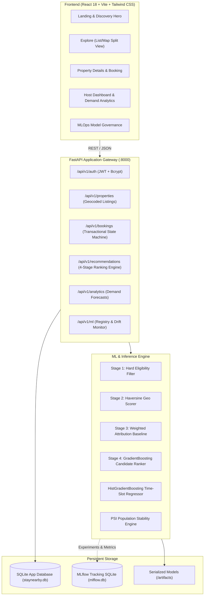
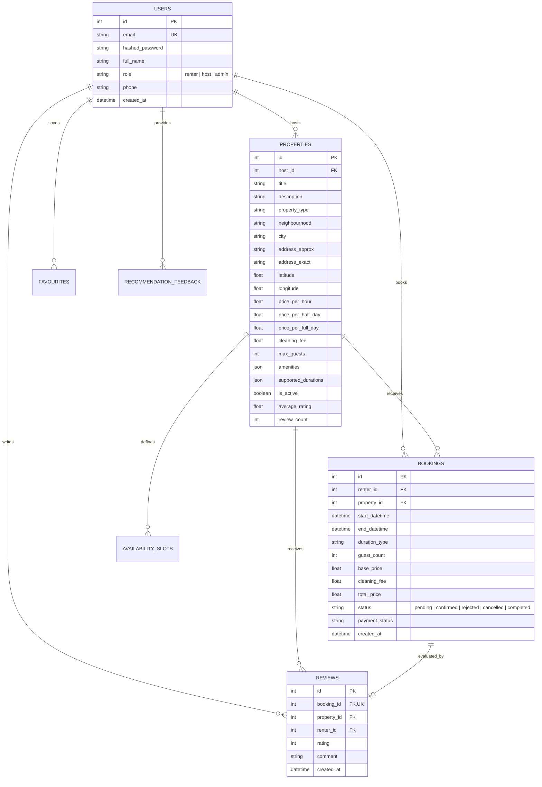

# StayNearby System Architecture

## 1. High-Level Architecture Overview

StayNearby is architectured as a decoupled, multi-tier web application built for high responsiveness, privacy-first property discovery, and explainable machine learning inference.

---

## 2. Relational Entity-Relationship Model

---

## 3. Privacy & Security Architecture

1. **Host Exact Address Shielding:**
   - Public exploration and detail pages (`GET /api/v1/properties`) return strictly `address_approx` (e.g. *"Near Guindy Metro Station, Chennai"*).
   - The private column `address_exact` is excluded from standard responses.
   - Only a renter who possesses a **confirmed** booking (`status == 'confirmed'`) can access the exact physical address via `GET /api/v1/bookings/my-bookings`.

2. **Booking Transaction Concurrency:**
   - To prevent double bookings for the same property across overlapping time periods, booking requests check confirmed booking collisions within a transactional lock.
   - Pricing calculations are strictly enforced server-side via the database entity prices; client-provided prices are ignored.

3. **Authentication & Authorization:**
   - Passwords hashed using bcrypt.
   - JWT tokens signed with HS256 containing user ID, role, and expiration timestamp.
   - Role-based dependencies (`get_current_active_user`, `require_host_role`, `require_admin_role`) guard protected administrative and host modification endpoints.
