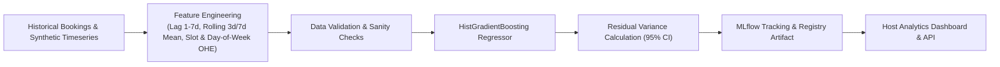

# StayNearby Machine Learning & MLOps Pipeline

StayNearby implements an industrial-grade ML pipeline combining transparent heuristic filtering with gradient boosted ranking and time-series forecasting.

---

## 1. Module A: Four-Stage Property Recommender

```mermaid
flowchart TD
    A["User Search Query<br/>(Location, Date, Duration, Budget, Guests, Amenities)"] --> B["Stage 1: Hard Eligibility Filter"]
    B -->|Active, Guest Cap, Supported Duration| C["Stage 2: Geospatial & Availability Filter"]
    C -->|Haversine Distance <= Radius (km)<br/>No Confirmed Booking Clashes| D["Stage 3: Weighted Heuristic Baseline"]
    D -->|Distance, Budget, Rating, Amenity Jaccard| E{"Model Registry Status"}
    E -->|Baseline Only / Cold Start| F["Explainable Ranking with Exact Feature Attributions"]
    E -->|Candidate Active| G["Stage 4: GradientBoosting Classifier Ranker"]
    G --> H["Calibrated Probabilities & Blended Explanations"]
    H --> I["Top-K Ranked Recommendations Returned to User"]
```

### Stage 1: Eligibility Filtering
- Filters out inactive properties (`is_active == False`).
- Enforces strict capacity requirements (`max_guests >= requested_guests`).
- Ensures requested duration type is in `supported_durations`.

### Stage 2: Geospatial & Availability Filtering
- Uses the Haversine formula to compute great-circle distance between user's target coordinates and property coordinates:
  $$d = 2r \arcsin\left(\sqrt{\sin^2\left(\frac{\Delta\phi}{2}\right) + \cos\phi_1\cos\phi_2\sin^2\left(\frac{\Delta\lambda}{2}\right)}\right)$$
- Discards listings outside the requested radius (default 15.0 km).
- Checks `bookings` table for overlapping confirmed reservations.

### Stage 3: Explainable Weighted Scoring
Calculates normalised sub-scores ($[0, 1]$):
1. **Distance Score ($w = 0.30$):** Inverse exponential decay over distance.
2. **Budget Fit ($w = 0.25$):** 1.0 if within budget, tapering down if over budget.
3. **Rating & Trust ($w = 0.20$):** Bayesian average rating based on reviews count.
4. **Amenity Match ($w = 0.15$):** Jaccard similarity of required vs offered amenities.
5. **Host Responsiveness & Prior Likes ($w = 0.10$):** Boost based on user favourites.

Provides clear attribution labels: *"Within 2.1 km of your search location"*, *"Well within your ₹600/hr budget"*, *"4.8★ rated with 14 verified reviews"*, *"Features Fast Wi-Fi and Dedicated Workspace"*.

### Stage 4: Supervised ML Candidate Ranker
- Trained on user interaction sequences (impressions, clicks, booking requests).
- **Architecture:** `GradientBoostingClassifier` with early stopping.
- **Features:** Geospatial distance, budget ratio, amenity overlap ratio, rating, log review count, duration match, hour of day, day of week.
- **Evaluation Metrics:** Precision@5, Recall@5, NDCG@5, Hit Rate@5.

---

## 2. Module B: Neighbourhood Demand Forecaster



- **Target:** Number of booking requests per neighbourhood and time-slot (`morning`, `afternoon`, `evening`, `night`).
- **Features:** 1-day, 2-day, 7-day lagged requests; 3-day and 7-day rolling means; one-hot encoded day of week, month, and time-slot; weekend indicator.
- **Model:** `HistGradientBoostingRegressor` handling non-linear interactions.
- **Confidence Intervals:** Computed using studentized residual variance:
  $$\hat{y} \pm 1.96 \cdot \text{RMSE}$$
- **Evaluation Metrics:** Mean Absolute Error (MAE), Root Mean Squared Error (RMSE), zero-safe Mean Absolute Percentage Error (MAPE).

---

## 3. Module C: MLOps & Continuous Monitoring

### Population Stability Index (PSI) Drift Engine
Calculates distribution shift between baseline reference features and recent inference logs:
$$\text{PSI} = \sum_{b=1}^{B} (P_b - Q_b) \cdot \ln\left(\frac{P_b}{Q_b}\right)$$
- $\text{PSI} < 0.10$: Stable distribution (No action needed).
- $0.10 \le \text{PSI} \le 0.25$: Slight drift detected (Warning banner displayed).
- $\text{PSI} > 0.25$: Significant data drift (Critical alert, model rollback or retraining recommended).

### Model Registry & Governance
The registry manifest (`backend/artifacts/model_manifest.json`) enforces atomic candidate activations:
- Multiple candidate models can be trained and evaluated concurrently.
- Models must pass validation gates (NDCG@5 > Baseline, RMSE < threshold) before promotion.
- One-click rollback to fallback heuristic baseline at any moment via the Admin MLOps Dashboard.

---

## 4. Synthetic Data Generation Methodology & Real-World Limitations

To enable fully offline, turnkey reproducibility without external paid APIs, StayNearby includes a synthetic generator (`backend/app/ml/synthetic_generator.py`).

### Generation Methodology
1. **Geographic Fidelity:** Calibrated to real Chennai coordinates across 8 primary micro-markets (Guindy, Velachery, Adyar, T. Nagar, Anna Nagar, Mylapore, OMR, Nungambakkam).
2. **Behavioral Realism:** Incorporates time-of-day demand spikes (evening/weekend leisure, weekday afternoon co-working) and log-normal price sensitivity distributions.
3. **Interactions:** Simulates 5,000 renter searches, click-throughs, and booking conversions.

### Real-World Limitations & Production Roadmap
- **Synthetic Correlation Artifacts:** In real production, seasonal weather anomalies (e.g. monsoons) and local events (cricket matches, tech conferences) create non-stationary demand spikes that synthetic Gaussian noise cannot replicate.
- **Feedback Loop Bias:** Machine-generated training data risks reinforcing algorithmic feedback loops (predicting high demand in areas that are frequently shown). Production systems require exploration-exploitation policies (e.g., $\epsilon$-greedy or Upper Confidence Bound bandit allocation).
- **Transition Strategy:** Once deployed, StayNearby automatically collects real `recommendation_feedback` and booking events into `recommendation_logs`. After 1,000 real interactions are logged, automated retraining switches the data source from synthetic seeds to real production logs.
